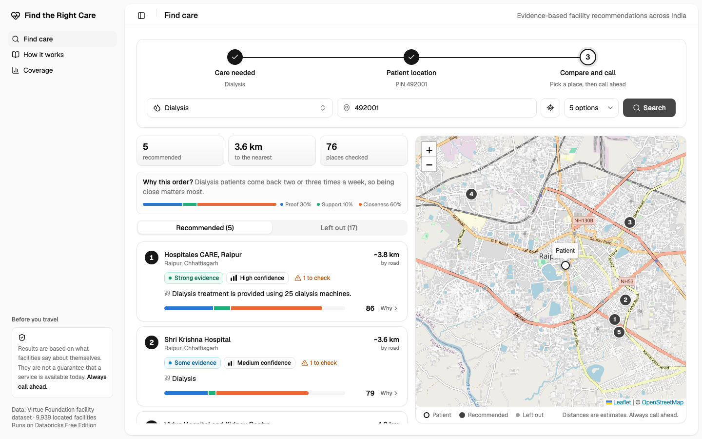
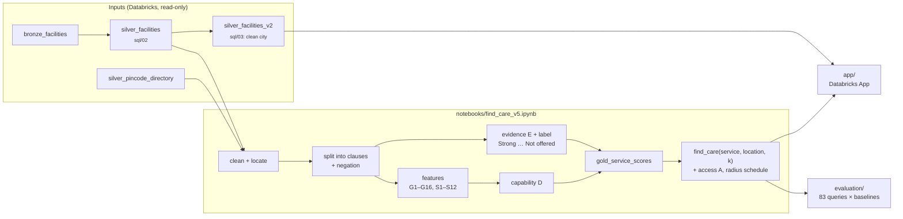

# Find the Right Care

[](https://github.com/Meet2304/Datathon26/actions/workflows/ci.yml)

**CMU Datathon Fall 2026 (Databricks track).** A health worker picks the **care needed** and says **where the patient is**. The system returns the best nearby facilities in India from the Virtue Foundation dataset (10,077 web-extracted facility records) and, for each one, answers:

- **Why this facility?** It quotes the facility's own record, verbatim, with an evidence label and a confidence level.
- **How did you decide?** It shows the score arithmetic (Evidence × Capability × Access) and the weights.
- **Why not the others?** Every nearby facility it considered but did not recommend is listed with the reason.

Everything is deterministic (regex + rules, no LLM in the ranking path), runs on Databricks Free Edition, and every claim it shows is a verbatim quote.

<p align="center"></p>

## Results at a glance

Evaluated on 83 test searches over all 10,077 facilities, against three baselines, with 1,422 blind-graded records (three LLM judges, quadratic-weighted κ 0.82). Full write-up: [evaluation/EVAL_RESULTS.md](evaluation/EVAL_RESULTS.md).

| Measure (both splits) | **Ours** | Most mentions (B1) | Biggest nearby (B2) |
|---|---|---|---|
| #1 result is a real on-site claim | **100%** | 93% | 41% |
| Median distance to the #1 result | **61 km** | 116 km | 114 km |
| Useful options within 25 km, per search | **1.13** | 0.65 | 0.22 |
| NDCG@5, held-out (ignores distance) | 0.777 | **0.836** | 0.407 |
| Non-verbatim quotes (90,693 facility × service cells) | **0** | – | – |

## How it works



- **Evidence `E`**: regex claim extraction over clause-split text, with negation ("dialysis not available"), look-alikes ("gastric bypass" is not cardiac surgery), de-duplication and corroboration rules. Labels: Strong / Moderate / Weak / Possible / No evidence / Not offered.
- **Capability `D`**: service-specific weighted prerequisites (e.g. dialysis unit, ICU, accreditation for dialysis). **Missing data lowers confidence, never rank.**
- **Access `A`**: road ≈ 1.4 × great-circle distance, with a per-service half-distance (15 km for dialysis and trauma … 150 km for cardiac surgery), and a 25 → 50 → 100 → 250 km search radius.

The full method is in [docs/METHODOLOGY.md](docs/METHODOLOGY.md) (start here), with [docs/PLAN_V5.md](docs/PLAN_V5.md) as the authoritative spec for the current version.

## Repository layout

```
.
├── notebooks/find_care_v5.ipynb   # THE pipeline: builds every table and defines find_care (Databricks notebook)
├── sql/                           # Silver-layer SQL, run in order (01 profiling, 02 silver_facilities, 03 v2 city cleaning)
├── app/                           # Databricks App: FastAPI back end + React front end (built bundle in app/static)
├── evaluation/                    # Evaluation on the real data: Databricks runner, results, raw run outputs
├── eval_bench/                    # Evaluation bench library (queries, pooling, grading, metrics) + Raipur pilot data
├── experiments/llm_vs_regex/      # 15-facility pilot that chose regex over LLM extraction (both arms, shared scorer)
├── scripts/                       # deploy_pipeline.py (run the notebook on Databricks), run_local_pipeline.py (local Spark)
├── results/pipeline/              # Recorded outputs of the Databricks and local runs
├── src/ftrc/                      # Small shared helpers for the scripts (paths, settings, notebook → source)
├── tests/                         # pytest: notebook hygiene, app/notebook consistency, reproducibility, local Spark run
├── docs/                          # Method, data dictionary, implementation notes, submission, reviews, history
└── video/                         # Remotion project for the submission video
```

## Quickstart (local, no Databricks needed)

Prerequisites: [uv](https://docs.astral.sh/uv/), and **Java 17** for the local Spark run (macOS: `brew install openjdk@17`). uv installs the pinned Python (3.12, from `.python-version`) and the locked dependencies (`uv.lock`).

```bash
git clone https://github.com/Meet2304/Datathon26.git && cd Datathon26
```

```bash
make setup        # uv sync --all-groups + git hooks
```

```bash
make test         # 22 tests, ~20 s: includes running the notebook end to end on local Spark
```

```bash
make pipeline-local   # run the notebook on the 15 Raipur pilot facilities; outputs in .local_spark/
```

`make help` lists every target. Without `make`, use the commands inside the [Makefile](Makefile) (they are all `uv run …`).

The local run builds a stand-in `silver_facilities` from the 15 pilot records, executes **every cell of the notebook** (all 12 regression fixtures are hard assertions), checks the 4 pilot expectations, and compares the answers to the recorded ones in [results/pipeline/local_pilot_responses.json](results/pipeline/local_pilot_responses.json).

## Reproducing the full results on Databricks

The full dataset lives in a Databricks workspace (`workspace.hackathon` schema) and is not redistributed here. With access to it:

1. **Configure.** `cp .env.example .env` and fill in `DATABRICKS_HOST`, `DATABRICKS_TOKEN` and `DATABRICKS_WAREHOUSE_ID`. `.env` is gitignored; never commit a token.
2. **Silver tables.** In a SQL warehouse run [sql/02_silver_facilities.sql](sql/02_silver_facilities.sql), then [sql/03_silver_facilities_v2.sql](sql/03_silver_facilities_v2.sql). `02` expects `silver_pincode_directory` and `ref_specialty_mapping` to exist (built by the team's earlier silver scripts; see [docs/DATA_DICTIONARY.md](docs/DATA_DICTIONARY.md)).
3. **Pipeline.** `make deploy-pipeline` uploads the notebook and runs it on serverless (about 3 minutes for 10,077 facilities). Or import `notebooks/find_care_v5.ipynb` into the workspace and choose *Run all*. Afterwards set the `rebuild` widget to `no`, pick a service and location, and run the **Your search** cell.
4. **Evaluation.** `make eval-deploy STAGE=all` runs the bench (prepare → grade with `ai_query` → evaluate) and downloads the outputs to `evaluation/runs/`.
5. **App.** `make app-build` (Node 20+) then `make app-deploy`. See [app/README.md](app/README.md) for the permissions the app's service principal needs.

## What is reproducible, and how it is checked

| Artefact | Reproduced by | Checked by |
|---|---|---|
| Notebook logic on the pilot (fixtures, pilot checks, answers) | `make pipeline-local` | `tests/test_pipeline_spark.py` (also in CI) |
| Eval-bench pilot report | `make pilot` | `tests/test_reproducibility.py` (byte-for-byte) |
| LLM-arm scoring of the extraction experiment | `experiments/llm_vs_regex/score_features.py` | `tests/test_reproducibility.py` (byte-for-byte) |
| App's ranking constants = notebook's | n/a | `tests/test_app_consistency.py` |
| Full 10k-facility build and evaluation | steps above | recorded in `results/pipeline/` and `evaluation/runs/` |

Two things can't be reproduced exactly: the LLM-judge grades (model sampling on Databricks `ai_query`; the grades used are committed in `evaluation/runs/silver_v5/`) and the LLM extraction arm of the pilot (its outputs are committed).

## Documentation

| Doc | What |
|---|---|
| [docs/METHODOLOGY.md](docs/METHODOLOGY.md) | **Start here.** The method in plain English, with pipeline and label flowcharts |
| [docs/PLAN_V5.md](docs/PLAN_V5.md) | v5 spec: pilot fixes X1–X7, scoring fixes R1–R6, output contract, regression fixtures. Overrides FEATURES/SCORING where they differ |
| [docs/FEATURES.md](docs/FEATURES.md) · [docs/SCORING.md](docs/SCORING.md) | Feature catalogue, missing-data rules, Depth weights · evidence, completeness, ranking, confidence |
| [docs/DATA_DICTIONARY.md](docs/DATA_DICTIONARY.md) | Bronze and silver tables |
| [docs/IMPLEMENTATION_NOTES.md](docs/IMPLEMENTATION_NOTES.md) | How the notebook was built and run, every runtime adaptation, tables created |
| [evaluation/EVAL_RESULTS.md](evaluation/EVAL_RESULTS.md) · [eval_bench/BENCH_DESIGN.md](eval_bench/BENCH_DESIGN.md) | Evaluation results · bench design |
| [docs/SUBMISSION.md](docs/SUBMISSION.md) | Datathon submission: requirements checklist, judging criteria, policy recommendations, known limits |
| [docs/reviews/](docs/reviews/) | Three independent reviews of the LLM-vs-regex pilot that shaped v5 |
| [docs/history/](docs/history/) | Earlier plans and validation reports, kept for the record |

## Known limits

- Grades measure what a record **supports**, not whether a service is available today; the app always says "call ahead".
- The relevance grades come from LLM judges, not people. A human grading pass is still to do.
- About 4 test searches per service per split, so per-service intervals are wide.

## Project history

Work happened on four branches (`docs/methodology`, `experiment/llm-vs-regex`, `experiment/regex-arm`, `unified`), plus code that only existed on team laptops (the notebook's build folder, the app, the evaluation). All of it is merged into `main`; the branch commits are preserved in the history.

Contributors (from the git history): Meet Bhatt, Praneet Karna, Shreyash Mishra.
