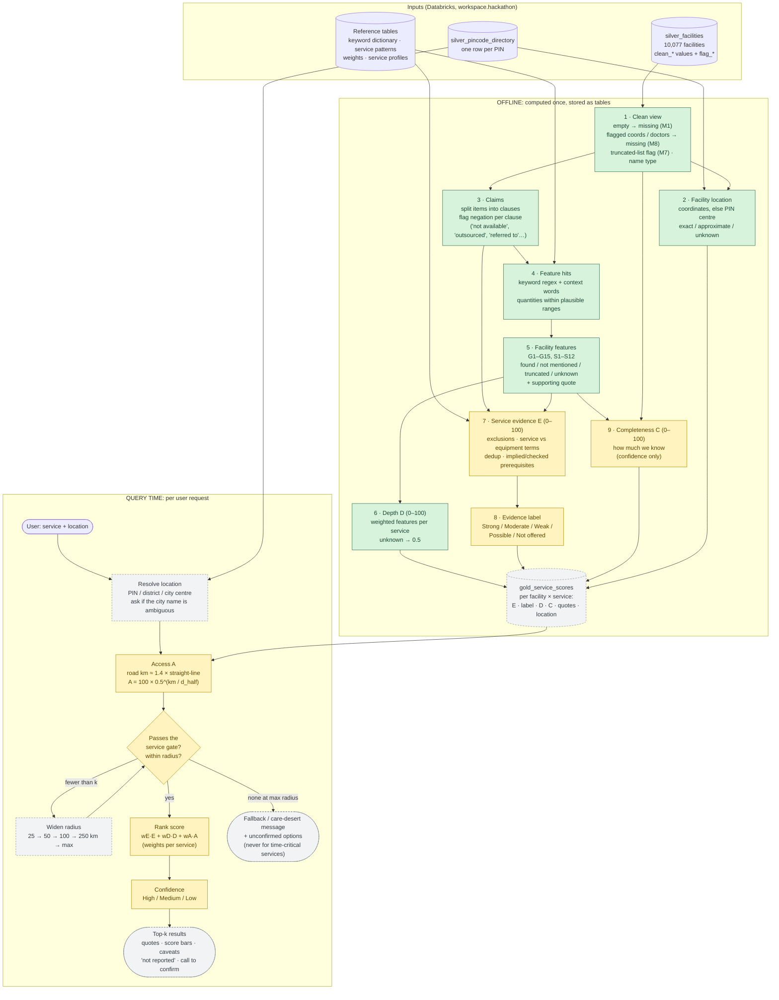
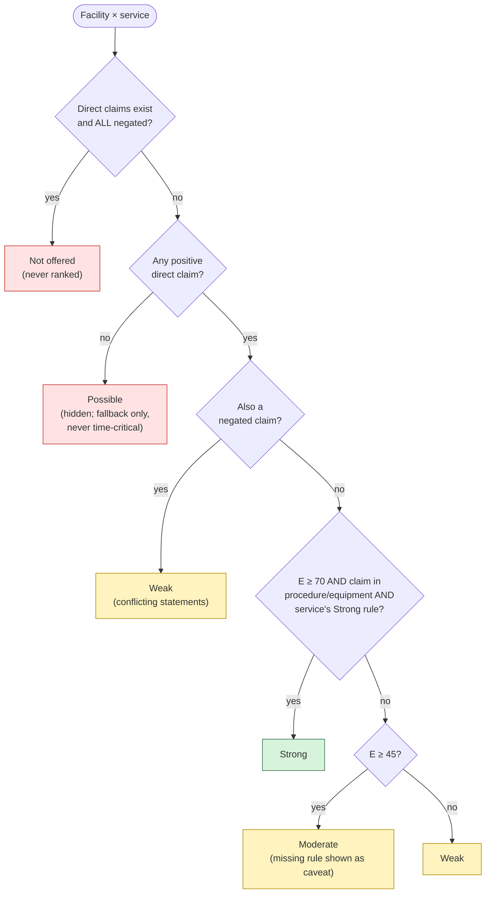

# Find the Right Care: Deterministic Methodology

> Status: **2026-11-21**. Summarises the current method. Full detail, SQL and weights: [FEATURES.md](FEATURES.md) (features, Depth, SQL) · [SCORING.md](SCORING.md) (evidence, completeness, ranking, evaluation) · [DATA_DICTIONARY.md](DATA_DICTIONARY.md) (tables).

## 1. The problem

A user (an ASHA worker, NGO coordinator or district planner) gives two inputs:
- a **service**: dialysis, emergency C-section, NICU, cardiac surgery, MRI, trauma, burn care *(beta)*, oncology, ENT;
- a **location**: PIN code, district or city in India.

The system returns the best nearby facilities. For each one it answers **why this facility** (verbatim quotes from its record) and **how we decided** (a visible score breakdown), and it states how sure it is.

## 2. Design choices

| Choice | Why |
|---|---|
| **Deterministic (regex + rules), not LLM extraction** | A 15-facility pilot found the two agree on 98.5% of values. The regex's few errors have cheap fixes. Regex is reproducible, cites text verbatim by construction, and runs in seconds instead of ~60–70 hours (§8) |
| **Input is clean: every value is valid or missing** | Team decision. The pipeline handles **missing** data, not wrong data. Two silver flags are treated as missing (M8) |
| **Missing ≠ negative** | A missing field lowers **confidence**, never **rank**, so small, thinly documented rural facilities aren't pushed down |
| **Every claim is a quote** | Nothing is shown as fact unless it's verbatim text from the facility's own record |
| **Additive, explainable scores** | Each point comes from a named rule a judge can check by hand |

## 3. Pipeline at a glance



**Legend:** 🟩 built in SQL and tested on all silver facilities · 🟨 implemented in Python (`run_regex.py`) and tested on the 15-facility pilot; SQL port pending · ⬜ specified, not yet built.

## 4. Offline stage (computed once)

| Step | What happens | Key rules |
|---|---|---|
| **1. Clean view** | Thin view over `silver_facilities`: `clean_name`, `clean_facility_type`, `clean_number_doctors`, `clean_capacity` / `clean_capacity_from_text`, `clean_specialties` / `clean_procedures` / `clean_equipment` / `clean_capabilities`, `clean_description`, `clean_latitude` / `clean_longitude`, `clean_pincode` | M1 empty → missing · M7 truncated if any `flag_*_truncated_50` · M8 `flag_coordinates_far_from_pincode` and `flag_numberDoctors_implausible` → missing · specialist type from name (e.g. "Kidney Centre") |
| **2. Location** | Facility coordinates, else the PIN centre from `silver_pincode_directory` (`is_primary_state` rows) | exact 8,460 · approximate 1,527 · unknown 90 |
| **3. Claims** | Every list item and the description, split into clauses on `;`, `. `, `, but/however/except` | Negation per clause: "not available", "outsourced", "referred to", "under construction", "upcoming", "proposed"… |
| **4. Feature hits** | Each clause tested against the keyword dictionary | Context words (newborn equipment needs a neonatal word) · quantities only within plausible ranges (ICU beds 1–200, MRI 0.2–7 T…) · specialty codes as weak (0.3) hits |
| **5. Features** | One value per facility × feature, with status and quote | found · not mentioned (0) · truncated / unknown (0.5) |
| **6. Depth D** | `100 × Σ weight × feature`, weights per service | Unknown counts as 0.5 and lowers coverage |
| **7. Evidence E** | Per facility × service | §6 below |
| **8. Label** | First matching rule (§6.3) | |
| **9. Completeness C** | Points for location precision, contact, doctors, beds, clinical text, year, freshness | Feeds confidence only |

### 4.1 Features used

| General (all services) | Service-specific |
|---|---|
| G1 facility type · G2 doctors · G3 beds · G4 ICU · G5 24×7 emergency · G6 ambulance · G7 operating theatre · G8 blood bank · G9 anaesthesia · G10 accreditation (JCI/NABH) · G11 lab accreditation (NABL) · G12 teaching hospital · G13 diagnostic breadth · G14 years operating · G15 specialist type from name (Strong rule only) | S1 dialysis equipment · S2 labour room · S3 NICU · S4 neonatal support (with neonatal context) · S5 cath lab · S6 CCU · S7 MRI (+ tesla) · S8 CT (+ slices) · S9 PET · S10 radiotherapy · S11 chemotherapy · S12 audiometry |

Access badges (filters, not scored): public/government · Ayushman Bharat / PM-JAY.

Specialty codes follow the silver table's standardised vocabulary (~103 codes, e.g. `obstetrics`, `cardiothoracicSurgery`, `neonatology`, `burnCare`; see `ref_specialty_mapping`).

Example Depth weights (each column sums to 1): **cardiac surgery** leans on cath lab .30, CCU .20, accreditation .15; **ENT** leans on doctors .35; **emergency C-section** on OT, blood bank and 24×7 (.20 each). Full matrix: FEATURES.md §3.3.

## 5. The scores

| Score | Range | Question | Used for |
|---|---|---|---|
| **E: Evidence** | 0–100 | Does the facility's own text say it offers the service? | gate + rank |
| **D: Depth** | 0–100 | How well equipped is it for this service? | rank |
| **A: Access** | 0–100 | How reachable is it from the user? | rank |
| **C: Completeness** | 0–100 | How much do we know about the facility? | confidence only |

```
rank_score = wE·E + wD·D + wA·A          (wE + wD + wA = 1, set per service)
A          = 100 × 0.5^(road_km / d_half),   road_km = 1.4 × straight-line km
```

## 6. Service evidence in detail

### 6.1 Extraction
1. **Direct terms** name the service (e.g. `caesarean|c-section|lscs`).
2. **Exclusions** cancel a match in the same clause: "gastric bypass" is not cardiac surgery; eye or dental trauma is not trauma.
3. **Service vs equipment:** "dialysis machines" is equipment, not a service claim, so one phrase isn't counted twice. If equipment is a facility's *only* mention, it still counts as a claim at ×0.8.
4. **Deduplicate** identical text across fields (the description often repeats the lists).
5. **Field weight:** procedure/equipment 1.0 · capability 0.9 · description 0.6, × specificity (quantity 1.2 · standard 1.0 · generic list 0.6).

### 6.2 Points
| Component | Points |
|---|---|
| Best direct claim | 0–40 |
| Corroboration: specialty code · service-specific equipment · a second distinct claim | 0–30 |
| Prerequisites (implied + checked) | 0–20 |
| A quantity in a claim | 0–10 |

**Prerequisites:** *implied* ones are met by a direct claim, because the service can't be done without them (C-section → OT + anaesthesia; cardiac surgery → OT + anaesthesia + ICU; trauma → 24×7). *Checked* ones must appear in the text (blood bank, nephrology, specialty codes). In a truncated record, an unfound prerequisite counts half.

### 6.3 Labels (first match wins)



**Strong rules** (service-specific equipment, not generic infrastructure):
- dialysis: dialysis equipment or a kidney-centre name;
- emergency C-section: emergency readiness stated in the same item;
- cardiac surgery: cath lab / CTICU / heart-lung machine, and not < 30 beds;
- MRI: MRI in equipment or with tesla/scanner;
- trauma: CT or ambulance.

ICU, blood bank or 24×7 alone never makes a result Strong.

## 7. Query-time ranking

| Service | Time-critical | wE / wD / wA | d_half | Max radius | Gate |
|---|---|---|---|---|---|
| Emergency C-section | **yes** | .30 / .10 / **.60** | 15 km | 100 km | Moderate |
| NICU | **yes** | .35 / .15 / **.50** | 25 km | 200 km | Moderate |
| Trauma | **yes** | .30 / .15 / **.55** | 15 km | 100 km | Moderate |
| Dialysis | recurring | .30 / .10 / **.60** | 15 km | 150 km | Moderate |
| MRI | no | .40 / .10 / .50 | 50 km | 300 km | Weak + MRI term |
| ENT | no | .40 / .30 / .30 | 40 km | 150 km | Weak |
| Burn care *(beta)* | no | .35 / .25 / .40 | 40 km | 400 km | Moderate |
| Cardiac surgery | no | .35 / **.45** / .20 | 150 km | 500 km | Moderate |
| Oncology | no | .35 / **.45** / .20 | 150 km | 500 km | Moderate |

1. Resolve the location (PIN → PIN centre; district or city → centre; **ask if a city name exists in more than one state**).
2. Widen the radius 25 → 50 → 100 → 250 km → service maximum until k results pass the gate.
3. Rank by `rank_score`. Add "**Stronger documented evidence, X km away**" when relevant.
4. Confidence: **Low** if the record is sparse, depth coverage < 0.4, or the location is approximate without Strong evidence; **High** if Strong + rich record + coverage ≥ 0.6; otherwise **Medium**.
5. If nothing passes: a care-desert message, plus unconfirmed options for non-time-critical services only.

**What the user sees:**
```
Fortis Hospital, Gurugram                     ~17 km (road est.) · Dialysis: STRONG · Confidence: High
 Why:
  ✓ Virtue Foundation record, capability: "Dialysis … 20-bed Dialysis Unit with 10 machines"
  ✓ Virtue Foundation record, specialties: nephrology
 Not reported:
  ? Number of nephrologists · Year established
 Listed in dataset. Call to confirm: +91 …
```
Confidence is shown as a word, never a percentage. URLs are listed as references, not as the source of a quote.

## 8. Evidence that the method works

**LLM vs regex pilot** (15 Raipur facilities × 3 queries, both arms scored by the same scorer; run on the bronze table before the switch to silver, with the v3 rules):

| | Result |
|---|---|
| Feature and evidence values that agree | **517 / 525 (98.5%)** |
| Evidence labels that agree | 44 / 45 |
| Made-up quotes | 0 (regex) · 0 (LLM) |
| Same top 3 | dialysis 2/3 · C-section 3/3 · cardiac 2/3 |
| Disagreements | LLM right 6 · debatable 2 · regex right 0 |

The regex's misses and false hits (e.g. "cardiac bypass surgery", "Non-NABH", "24x7 nursing") have specific fixes, which are pending (§10). Human-graded NDCG is still to come.

**Silver re-run:** the deterministic flow was re-run on the same 15 facilities from `silver_facilities` (`experiments/llm_vs_regex/silver_rerun/`). Every evidence label and E score matches the bronze run; only small ranking shifts appear, from silver's PIN-centre query points.

**Planned evaluation** (SCORING.md §7): blind labelling of what the record supports; regex precision and recall per service; negation accuracy; label monotonicity (Strong > Moderate > Weak); ranking vs baselines (nearest keyword match, keyword count, largest nearby); ablations; ±20% weight sensitivity; automatic honesty checks. About 8 person-hours in total.

## 9. Limitations

- **Records, not reality:** we measure what the facility's text supports, not whether the service is available today. Every result says "call to confirm".
- **No outcome data:** "capability" is never presented as quality.
- **Thin and urban-heavy coverage:** many districts have few facilities with any claim. The fallback says so honestly.
- **Straight-line distance × 1.4** approximates road distance and may be low in hilly regions.
- **Lists cut at 50 items** (21% of facilities): handled as unknown, but large hospitals may lose evidence.
- **Burn care** is beta: it rests mostly on one specialty code.

## 10. Status and next steps

| Part | Status |
|---|---|
| Clean view, location, claims, features, Depth D (SQL) | ✅ built and tested on all 10,077 silver facilities |
| Evidence E, labels, completeness C, ranking | 🟨 working in Python on silver (`experiments/llm_vs_regex/run_regex.py`), tested on the 15-facility pilot |
| `gold_facility_completeness`, `gold_service_evidence` (SQL) | ⬜ to build |
| `gold_service_scores` + `find_care` query function | ⬜ specified; depends on the two tables above |
| Five regex fixes from the pilot | ⬜ to apply |
| Human grading + 20-query evaluation | ⬜ to run |
